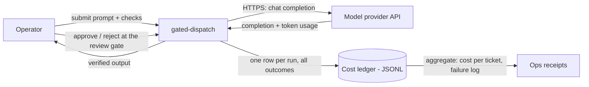
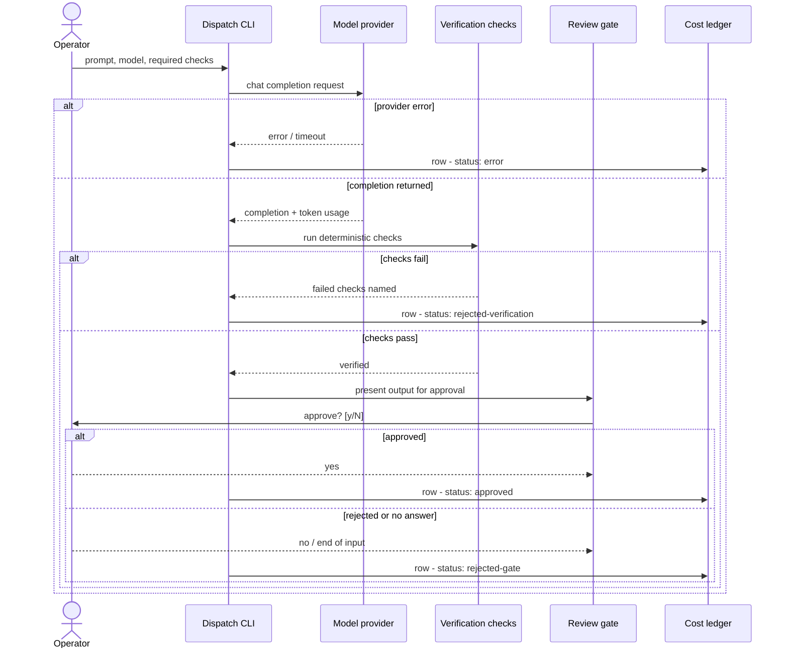

# Diagrams

Public vocabulary throughout: *change control* = the review-and-approval discipline around every dispatch; *review gate* = the human approval step; *ledger* = the append-only operating record.

## Context diagram

Where gated-dispatch sits: an operator submits work, an external model provider executes it, and every outcome lands in a ledger the operator can audit and publish.

## Sequence diagram

One dispatch, end to end — including the three ways it can end without approval. Exactly one ledger row is written on every path.

